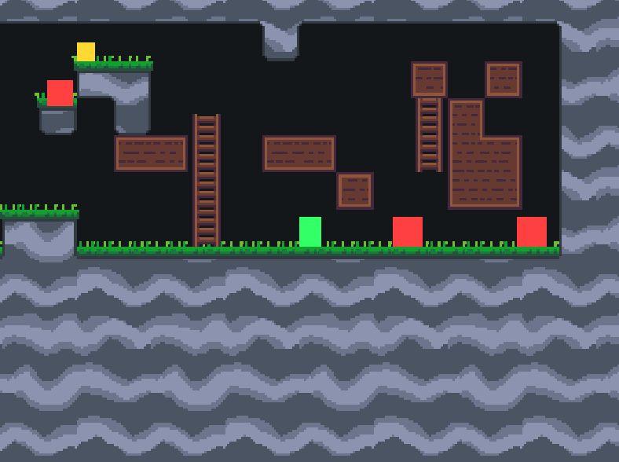

# Platosku 2

This is my platformer game (prototype) written in rust.



## TODO / Ideas

 * Player
   * [x] Safe platform edge jumping helping (coyote time)
   * [x] Long press / short press jumping
   * [x] Hitpoints and taking damage (health bar, immunity frames)
   * [ ] Dying properly (the player falls over, but there is no game over / restart yet)
 * Boxes/Crates that are breakable
   * [x] Break by swinging, drop coins
   * [ ] Drop other loot
 * [x] Throwing things (carried items can be thrown, dropped and picked up)
 * [ ] Push blocks
 * [ ] Score / coin counter (collecting coins plays a sound but is not counted yet)
 * Enemies
   * [x] Bat
   * [x] Slime
   * [x] Worm
   * [x] Burrower (shoots green projectiles)
 * Map
   * [x] Map editor
   * [x] Door between rooms
   * [x] Platforms (pressing down+jump drops you down)
   * [x] Minimap
   * [ ] Doors close until the room's enemies are dead (code exists, currently disabled: `TODO: TEMP` in `Game::update`)
   * [ ] Use the room `disabled` flag in map generation (currently only the editor uses it)
 * Optimizations
   * [x] All sprites use just one draw call
   * [ ] Less looping over things multiple times

## Testing and tools

```
cargo test --all-targets                                     # unit + e2e tests (headless, run in CI)
cargo run --example run_script -- scripts/jump_demo.txt      # run an input script, print game state
cargo run --example capture -- scripts/jump_demo.txt         # run an input script, save screenshots
cargo run --example sprite_sheet -- character                # enlarged sprite frames as a PNG
```

E2E tests drive the game headlessly with a `Sim` (`src/sim.rs`), and input scripts
(`scripts/*.txt`, format in `src/script.rs`) can be played back both headlessly and with
screenshots. Output goes to `target/claude/`. The game prints its random seed at startup
(`Game seed: N`), and `Game::new_with_seed(N)` reproduces that run. See `CLAUDE.md` for details.

## Linters

Run linters locally with this command

```
cargo fix --bin platosku2 && cargo check && cargo fmt --all -- && cargo clippy --fix && cargo test
```

CI runs `cargo fmt --all -- --check`, `cargo clippy --all-targets -- -D warnings` and
`cargo test --all-targets`, so any clippy warning fails the build.

OR

```
cargo fix --bin platosku2 
cargo check 
cargo fmt --all -- 
cargo clippy --fix 
cargo test
git add .
git commit -m "TMP linter fixes"
```

## Regenerate texture atlas:

Run this command to regenrate texture atlas

```
aseprite assets/sprites/*.aseprite --sheet-pack --sheet assets/atlas.png --data assets/atlas.json --batch --format json-array
```

## Sounds

Run `sh make_sound_variants.sh` to generate different pitch and DB versions of the sounds.
